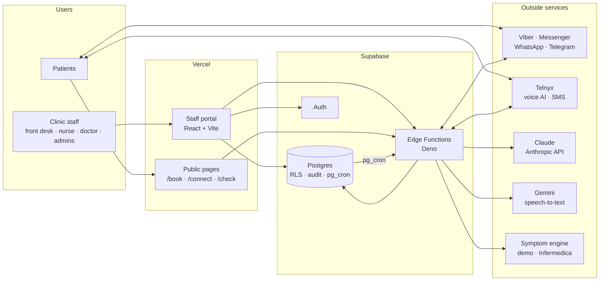

# CareCall PH architecture

How the system is put together: the parts, where data lives, who can see what,
which outside services are used, and how the main flows run. For setup see the
[README](../README.md); for status and plans see [ROADMAP.md](../ROADMAP.md).

**Last updated:** 13 October 2026

## 1. Overview

- **Supabase is the single source of truth**: patients, clinicians and their
  hours, appointments, campaigns, messages, medicines, clinical notes, consents
  and the audit log.
- **The portal talks to Postgres directly** for ordinary reads and writes.
  Row-level security (RLS) decides what each user may see and change. Anything
  that needs secrets, outside services or extra checks goes through an Edge
  Function.
- **Edge Functions** use the service-role key and bypass RLS, so each checks
  the caller itself (signed-in user, shared secret, platform signature, booking
  token or service key).
- **pg_cron** drives everything scheduled by calling functions with the
  service key (stored in Supabase Vault).

## 2. Portal (web/)

- Vite + React + TypeScript, hosted on Vercel. One build, two apps loaded on
  demand: the **staff portal** and the small **public app** for patient links
  (`/book/<token>`, `/connect/<token>`, `/check`), so patients never download
  staff code.
- Only `VITE_SUPABASE_URL` and `VITE_SUPABASE_ANON_KEY` are built in. No
  secret key ever goes to Vercel.
- **Sessions**: the sign-in lives in `sessionStorage`, shared between open
  portal tabs over a BroadcastChannel (`lib/tabSession.ts`). Closing the browser
  signs out. After 20 minutes without activity in any tab the user is signed
  out, with a warning 2 minutes before (`lib/idle.ts`).
- **CC** (the assistant) is a drawer on every screen, opened from the logo.

## 3. Edge Functions (supabase/functions/)

| Function | Called by | Auth | What it does |
|---|---|---|---|
| `admin-manage` | Portal | Sign-in | Users (access level, clinical role, make doctor), clinics, passwords |
| `channel-invite` | Portal | Sign-in | "Invite to chat" links and QR codes |
| `care-plan` | Portal | Sign-in, nurse/doctor | Ask a patient to agree to medicine reminders; stop them |
| `clinical-note` | Portal | Sign-in, nurse/doctor | Speech-to-text, CC drafts a SOAP note, doctor signs (password) |
| `fhir` | Portal (and FHIR clients) | Sign-in, nurse/doctor for records | FHIR R4 export with PH Core profiles |
| `cc-chat` | Portal | Sign-in | CC conversations (runs as the user, RLS applies) |
| `cc-nightly` | pg_cron 02:00 Manila | Service key | CC's nightly review per clinic |
| `start-campaign` | pg_cron every minute | Service key | Pre-call message, then dial; respects hours, status, do-not-call |
| `send-reminders` | pg_cron every 5 minutes | Service key | Appointment reminders (24 h, 2 h) and medicine reminders; marks missed doses |
| `telnyx-call-events` | Telnyx | Webhook (signature check planned) | Call events: answering-machine detection, voicemail follow-up, hangup |
| `assistant-tools` | Telnyx voice AI | Shared secret | `verify_patient`, slots, `create_appointment`, `mark_outcome` |
| `booking-api` | Patients' browsers | Booking token | Self-booking from `/book/<token>` |
| `symptom-check` | Patients' browsers, Telegram | Public, rate-limited | Symptom check with the Philippine layer; booking from the result |
| `channel-webhook` | Chat platforms | Platform signature / secret | Inbound chat: opt-in YES, STOP, BOOK, reminder and dose replies, `/check` |

Shared code in `_shared/`: `lib.ts` (clients, `getCaller`, audit,
`verifyPassword`), `roles.ts`, `channels.ts` (send by the patient's preferred
app, falling back by Philippine reach), `reminders.ts`, `care.ts`, `notes.ts`,
`fhir/` (mapping and PH Core systems), `symptom/` (engines and PH layer), `cc/`
(CC tools and the generated wiki bundle). Pure modules have Deno tests.

## 4. Data (supabase/migrations/)

| Area | Tables |
|---|---|
| Clinics and people | `clinics`, `providers` (clinicians, PRC number, optional login), `provider_availability`, `patients` |
| Scheduling | `appointments` (no double-booking: exclusion constraint), `booking_links`, `appointment_reminders`, `appointment_type_assistants` |
| Outreach | `campaigns`, `campaign_patients`, `call_logs` |
| Chat | `patient_channels` (opt-in per app), `channel_invites`, `channel_messages` |
| Symptom check | `symptom_checks` (deleted after 90 days), `symptom_rate_limits`, `booking_rate_limits` |
| Care plans | `care_consents`, `medications`, `medication_doses` |
| Clinical notes | `clinical_notes` (draft → signed, addenda) |
| CC | `cc_usage`, `cc_reviews`, `cc_action_items` |
| Platform | `platform_settings` (e.g. records retention), `audit_log` |

Scheduled jobs (pg_cron): `carecall_tick` (every minute, campaigns),
`carecall_reminders` (every 5 minutes), `carecall_cc_nightly` (18:00 UTC =
02:00 Manila), `carecall_symptom_check_retention` (daily, 90-day deletion).

## 5. Who can see what

Every user has two settings, both stored in the sign-in token (`app_metadata`)
and written only by `admin-manage`:

| Access level | Scope |
|---|---|
| Platform admin (`admin`) | All clinics; global settings; can make other platform admins |
| Clinic admin | One clinic: patients, clinicians, campaigns, clinic settings, users |
| Staff | One clinic: campaigns, review queue, booking and messaging |

| Clinical role | Can |
|---|---|
| Front desk | Bookings and messages; intake urgency only; medicines view-only; no clinical notes |
| Nurse / assistant | Intake details; add and stop medicines; ask for reminder consent; draft notes; FHIR download |
| Doctor | As nurse, plus sign clinical notes (password re-entered); linked to a clinician with a PRC number |

Enforced in the database: SQL helpers `jwt_clinic_id()`, `is_admin()`,
`is_clinic_admin()`, `jwt_clinical_role()`, `can_manage_care()` and
`is_doctor()` are used by RLS policies on every table, and Edge Functions check
the same rules. Hiding a button is never the only control.

**Audit**: changes to patients, campaigns, clinics, medicines, consents and
settings are written to `audit_log` by triggers; clinical notes are audited
without their text. Functions also log exports (`fhir_export`), signatures
(`clinical_note_signed`, failed attempts) and user changes.

**Consent** is recorded, never assumed: SMS consent per patient, chat apps by
the patient's YES (`patient_channels`), medicine reminders in the chat
(`care_consents`, versioned wording), and consultation recordings (ticked by
the doctor, stored on the note).

## 6. AI and outside services

| Service | Used for | What it receives |
|---|---|---|
| Claude (Anthropic) | CC chat and nightly review (`CC_MODEL`); drafting clinical notes (`NOTES_MODEL`) | CC: aggregate figures only, never names, phones or birthdates. Notes: the transcript plus age and sex |
| Gemini (Google) | Speech-to-text for clinical notes | The audio, sent once; CareCall never stores it |
| Telnyx | Voice AI calls, SMS | Call audio, phone numbers |
| Viber, Meta (Messenger, WhatsApp), Telegram | Patient messages | Phone or chat ID and message text (no diagnoses) |
| Symptom engine (demo, Infermedica) | Symptom check | Age band, sex, answers; no name or contact details |

Each needs a processing agreement before real patient data is used (Data
Privacy Act). Secrets live only in Supabase (`supabase secrets set`).

## 7. Main flows

**Chat campaign to booking**: staff create a chat campaign → `start-campaign`
sends each patient a booking link on their chat app → the patient picks a slot
on `/book/<token>` → `booking-api` books it (double-booking impossible) →
`send-reminders` reminds 24 h and 2 h before → replies (1 confirm, 2 change,
3 cancel) arrive at `channel-webhook`.

**Symptom check**: patient opens the clinic's link or `/check` (or `/check` in
Telegram) → emergency questions first (911 screen) → engine questions inside
the Philippine layer → urgency and kind of doctor → optional booking, with the
summary shared on the appointment.

**Medicine reminders**: a nurse or doctor adds medicines → `care-plan` asks
the patient to agree in the chat → YES recorded → `send-reminders` sends each
dose time → 1 taken / 2 skipped, or missed after 2 hours → adherence on the
patient page.

**Clinical note**: the doctor dictates, records the consultation with consent,
or types → `clinical-note` transcribes (Gemini) → Claude drafts a SOAP note
with a check-before-signing list → the doctor edits and signs with their
password → the note is final; corrections are signed addenda.

**FHIR export**: a nurse or doctor clicks **Download record (FHIR)** → `fhir`
checks the clinic and role, maps the rows to FHIR R4 with PH Core profiles
(Patient, Practitioner, Organization, Appointment, MedicationRequest,
MedicationAdministration, Consent, Encounter, Composition) and logs the export.
Records stay in CareCall's tables; FHIR is produced on request
([fhir-design.md](fhir-design.md)).

**Records retention**: platform default 7 years after the last consultation
(Global settings), optional per clinic; `records_due_for_review()` lists
patients past the period in Clinic settings. Nothing is deleted automatically.

## 8. Design docs

| Doc | Covers |
|---|---|
| [messaging-channels.md](messaging-channels.md) | Chat apps, opt-in, fallback |
| [cc-assistant.md](cc-assistant.md) | CC, its tools, nightly review, wiki |
| [symptom-check-design.md](symptom-check-design.md) | Symptom check, engines, Philippine layer |
| [care-plan-design.md](care-plan-design.md) | Clinical roles, medicine reminders, prescriptions, vital signs, clinical notes |
| [fhir-design.md](fhir-design.md) | FHIR-ready records, PH Core mapping, export |
| [self-booking-link-spec.md](self-booking-link-spec.md) | Booking links |
