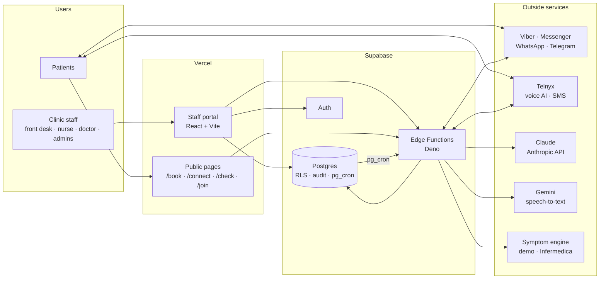

# CareCall PH architecture

How the system is put together: the parts, where data lives, who can see what,
which outside services are used, and how the main flows run. For setup see the
[README](../README.md); for status and plans see [ROADMAP.md](../ROADMAP.md).

**Last updated:** 13 October 2026

## 1. Overview

- **Supabase is the single source of truth**: patients, clinicians and their
  hours, appointments, campaigns, messages, medicines, clinical notes, consents
  and the audit log.
- **The portal talks to Postgres directly** for ordinary reads and writes.
  Row-level security (RLS) decides what each user may see and change. Anything
  that needs secrets, outside services or extra checks goes through an Edge
  Function.
- **Edge Functions** use the service-role key and bypass RLS, so each checks
  the caller itself (signed-in user, shared secret, platform signature, booking
  token or service key).
- **pg_cron** drives everything scheduled by calling functions with the
  service key (stored in Supabase Vault).

## 2. Portal (web/)

- Vite + React + TypeScript, hosted on Vercel. One build, two apps loaded on
  demand: the **staff portal** and the small **public app** for patient links
  (`/book/<token>`, `/connect/<token>`, `/check`, `/join/<clinic>`), so patients never download
  staff code.
- Only `VITE_SUPABASE_URL` and `VITE_SUPABASE_ANON_KEY` are built in. No
  secret key ever goes to Vercel.
- **Sessions**: the sign-in lives in `sessionStorage`, shared between open
  portal tabs over a BroadcastChannel (`lib/tabSession.ts`). Closing the browser
  signs out. After 20 minutes without activity in any tab the user is signed
  out, with a warning 2 minutes before (`lib/idle.ts`).
- **CC** (the assistant) is a drawer on every screen, opened from the logo.

## 3. Edge Functions (supabase/functions/)

| Function | Called by | Auth | What it does |
|---|---|---|---|
| `admin-manage` | Portal | Sign-in | Users (access level, clinical role, make doctor), clinics, passwords |
| `channel-invite` | Portal | Sign-in | "Invite to chat" links and QR codes |
| `appointment-notify` | Portal | Sign-in | Tells the patient when staff book, move or cancel an appointment |
| `patient-signup` | Patients' browsers (front desk QR poster) | Public, rate-limited | Patients register themselves; new records get a pre-verified chat invite |
| `care-plan` | Portal | Sign-in, nurse/doctor | Ask a patient to agree to medicine reminders or vital signs; stop them; doctor signs a monitoring plan (password) |
| `clinical-note` | Portal | Sign-in, nurse/doctor | Speech-to-text, CC drafts a SOAP note or a dictated monitoring plan, doctor signs notes (password) |
| `fhir` | Portal (and FHIR clients) | Sign-in, nurse/doctor for records | FHIR R4 export with PH Core profiles |
| `cc-chat` | Portal | Sign-in | CC conversations (runs as the user, RLS applies) |
| `cc-nightly` | pg_cron 02:00 Manila | Service key | CC's nightly review per clinic |
| `start-campaign` | pg_cron every minute | Service key | Pre-call message, then dial; respects hours, status, do-not-call |
| `send-reminders` | pg_cron every 5 minutes | Service key | Appointment reminders (24 h, 2 h), medicine reminders and vital-sign requests; marks missed doses and readings; hourly missed-dose and no-reading alerts |
| `telnyx-call-events` | Telnyx | Ed25519 signature (or secret URL token) | Call events: answering-machine detection, voicemail follow-up, hangup |
| `assistant-tools` | Telnyx voice AI | Shared secret | `verify_patient`, slots, `create_appointment`, `mark_outcome` |
| `booking-api` | Patients' browsers | Booking token | Self-booking from `/book/<token>` |
| `symptom-check` | Patients' browsers, Telegram | Public, rate-limited | Symptom check with the Philippine layer; booking from the result |
| `channel-webhook` | Chat platforms | Platform signature / secret | Inbound chat: opt-in YES, STOP, BOOK, reminder, dose and reading replies, `/check` |

Shared code in `_shared/`: `lib.ts` (clients, `getCaller`, audit,
`verifyPassword`), `roles.ts`, `channels.ts` (send by the patient's preferred
app, falling back by Philippine reach), `reminders.ts`, `care.ts`, `care_db.ts`, `vitals.ts`, `notes.ts`,
`fhir/` (mapping and PH Core systems), `symptom/` (engines and PH layer), `cc/`
(CC tools and the generated wiki bundle). Pure modules have Deno tests.

## 4. Data (supabase/migrations/)

| Area | Tables |
|---|---|
| Clinics and people | `clinics`, `providers` (clinicians, PRC number, optional login), `provider_availability`, `patients` |
| Scheduling | `holidays`, `clinic_closures` (no slots on closed days), `appointments` (no double-booking: exclusion constraint), `booking_links`, `appointment_reminders`, `appointment_type_assistants` |
| Outreach | `campaigns`, `campaign_patients`, `call_logs` |
| Chat | `patient_channels` (opt-in per app), `channel_invites`, `channel_messages` |
| Symptom check | `symptom_checks` (deleted after 90 days), `symptom_rate_limits`, `booking_rate_limits` |
| Care plans | `care_consents` (scopes: medicine reminders, vital signs), `medications`, `medication_doses`, `monitoring_plans` (draft → signed → replaced / stopped), `vital_plans`, `vital_requests`, `vital_readings` |
| Clinical notes | `clinical_notes` (draft → signed, addenda) |
| Pilot dashboard | `pilot_dashboard(clinic, days)`: counts only, clinic-checked, care numbers for nurses/doctors/admins; `clinics.baseline_no_show_pct`; attendance = appointments marked `completed` / `no_show` |
| CC | `cc_usage`, `cc_reviews`, `cc_action_items` (clinical items for nurses and doctors only), `care_alerts`, `bug_reports` (filed through CC by the user, own reports only; platform admins triage; `diagnostics` = the page's recent errors and failed requests, scrubbed in the browser and in cc-chat), `bug_report_screenshots` (masked page captures, admins only, purged after 90 days) |
| Privacy | `data_requests` (access, correction, restriction, erasure), `record_disposals` (no personal data); `patients.restricted_at` |
| Platform | `platform_settings` (e.g. records retention), `audit_log` |

Scheduled jobs (pg_cron): `carecall_tick` (every minute, campaigns),
`carecall_reminders` (every 5 minutes), `carecall_cc_nightly` (18:00 UTC =
02:00 Manila), `carecall_symptom_check_retention` (daily, 90-day deletion),
`carecall_contact_purge` (03:45 Manila: old messages, call transcripts and
recording links, spent invites and booking links).

## 5. Who can see what

Every user has two settings, both stored in the sign-in token (`app_metadata`)
and written only by `admin-manage`:

| Access level | Scope |
|---|---|
| Platform admin (`admin`) | All clinics; global settings (records retention, message-history defaults, holiday list); can make other platform admins |
| Clinic admin | One clinic: patients, clinicians, campaigns, clinic settings (holidays and closures, message history), users; answers privacy requests and disposes of records past retention |
| Staff | One clinic: campaigns, review queue, booking and messaging; logs patients' privacy requests |

| Clinical role | Can |
|---|---|
| Front desk | Bookings and messages; intake urgency only; medicines view-only; no clinical notes |
| Nurse / assistant | Intake details; add and stop medicines; ask for reminder consent; draft notes and monitoring plans; see and review readings; FHIR download |
| Doctor | As nurse, plus sign clinical notes and monitoring plans (password re-entered); linked to a clinician with a PRC number |

Enforced in the database: SQL helpers `jwt_clinic_id()`, `is_admin()`,
`is_clinic_admin()`, `jwt_clinical_role()`, `can_manage_care()` and
`is_doctor()` are used by RLS policies on every table, and Edge Functions check
the same rules. Hiding a button is never the only control.

**Audit**: changes to patients, campaigns, clinics, medicines, consents,
monitoring plans, readings, privacy requests, holidays and settings are written
to `audit_log` by triggers; clinical notes are audited without their text.
Functions also log exports (`fhir_export`), signatures (`clinical_note_signed`,
`monitoring_plan_signed`, failed attempts), dictation, privacy actions
(`data_request_*`, `record_disposed`), the nightly purge
(`contact_history_purged`) and user changes. Disposal blanks the patient's data
in older audit rows and keeps who did what and when.

**Consent** is recorded, never assumed: SMS consent per patient, chat apps by
the patient's YES (`patient_channels`), medicine reminders and vital
signs in the chat (`care_consents` with scopes, versioned wording), and consultation recordings (ticked by
the doctor, stored on the note).

## 6. AI and outside services

| Service | Used for | What it receives |
|---|---|---|
| Claude (Anthropic) | CC chat and nightly review (`CC_MODEL`); drafting clinical notes and dictated monitoring plans (`NOTES_MODEL`) | CC: aggregate figures only, never names, phones or birthdates (patient action items reach CC as "(a patient)"). Notes: the transcript plus age and sex. Plans: the dictation only |
| Gemini (Google) | Speech-to-text for clinical notes and dictated plans | The audio, sent once; CareCall never stores it |
| Telnyx | Voice AI calls, SMS | Call audio, phone numbers. Webhooks must be signed (`TELNYX_PUBLIC_KEY`, not set until the PH account exists) |
| Viber, Meta (Messenger, WhatsApp), Telegram | Patient messages | Phone or chat ID and message text (no diagnoses) |
| Symptom engine (demo, Infermedica) | Symptom check | Age band, sex, answers; no name or contact details |
| Google Places API (New) | Nearby care: nearest ERs, clinics, a typed town | The patient's location (or typed place) for one lookup; never stored by CareCall |

Each needs a processing agreement before real patient data is used (Data
Privacy Act). Secrets live only in Supabase (`supabase secrets set`).

## 7. Main flows

**Chat campaign to booking**: staff create a chat campaign → `start-campaign`
sends each patient a booking link on their chat app → the patient picks a slot
on `/book/<token>` (no slots on holidays or clinic closures) → `booking-api`
books it (double-booking impossible) →
`send-reminders` reminds 24 h and 2 h before → replies (1 confirm, 2 change,
3 cancel) arrive at `channel-webhook`.

**Staff booking**: on the patient page anyone at the clinic picks a clinician
and an open slot (`get_available_slots`) and books, reschedules (one update:
the old time is freed as the new one is taken) or cancels; the database refuses
double bookings and a patient–clinician clinic mismatch, and logs every change
(`fn_audit_appointment`). Reminders follow the current time. With **Send the
patient a message** ticked (default) the portal then calls `appointment-notify`,
which checks the clinic and that the appointment's state still matches
(booked/moved vs cancelled), sends `appointmentChangeText` through
`sendToPatient` (never to restricted, inactive or do-not-call patients) and
audits `appointment_notified`.

**Patient sign-up**: the clinic's QR poster opens `/join/<public_slug>`; the
patient types name, mobile and birthday, accepts the privacy notice (version
stored on the record) and ticks chat and texts. `patient-signup` creates the
record and, for chat, a `channel_invites` row marked `verified` (1 day), so
`channel-webhook` skips the birthday question and asks only for YES. An
existing (clinic, mobile, birthday) match is never changed and gets no token.

**Symptom check**: patient opens the clinic's link or `/check` (or `/check` in
Telegram) → emergency questions first (911 screen) → engine questions inside
the Philippine layer → urgency and kind of doctor → optional booking, with the
summary shared on the appointment.

**Medicine reminders**: a nurse or doctor adds medicines → `care-plan` asks
the patient to agree in the chat → YES recorded → `send-reminders` sends each
dose time → 1 taken / 2 skipped, or missed after 2 hours → adherence on the
patient page.

**Vital signs**: a nurse or doctor drafts a monitoring plan (measures, times,
target and critical limits, what to do if high or low), typed or dictated
(`clinical-note` `plan_draft`: CC fills in only what was said and lists what
to check) → a doctor signs it
with their password → `care-plan` asks the patient to agree → YES sends the
plan → `send-reminders` asks for readings at the plan's times → replies at
`channel-webhook` are parsed and checked against the doctor's limits only →
out-of-range and critical readings go to Readings to review and CC action
items; critical replies tell the patient to call 911 first. Hourly,
`send-reminders` files an alert for 3 missed doses in a row or no readings for
3 days (once per streak, `care_alerts`); CC's `care_report` gives the clinic's
adherence, response rate and BP trend as counts.

**Clinical note**: the doctor dictates, records the consultation with consent,
or types → `clinical-note` transcribes (Gemini) → Claude drafts a SOAP note
with a check-before-signing list → the doctor edits and signs with their
password → the note is final; corrections are signed addenda.

**FHIR export**: a nurse or doctor clicks **Download record (FHIR)** → `fhir`
checks the clinic and role, maps the rows to FHIR R4 with PH Core profiles
(Patient, Practitioner, Organization, Appointment, MedicationRequest,
MedicationAdministration, Consent, Encounter, Composition, Observation,
CarePlan) and logs the export.
Records stay in CareCall's tables; FHIR is produced on request
([fhir-design.md](fhir-design.md)).

**Records retention**: platform default 7 years after the last consultation
(Global settings), optional per clinic; `records_due_for_review()` lists
patients past the period in Clinic settings. Medical records are never
deleted automatically. Contact history is: `purge_contact_history()` nightly
deletes messages after 365 days and blanks call transcripts and recording links
after 90 (platform defaults, per clinic).

**Privacy requests**: any staff member logs a patient's request on the patient
page (a CC action item goes to the clinic admins) → a clinic admin answers it
through database functions, one transaction each: `data_request_complete`
(access via the FHIR download, correction), `data_request_restrict` (no
messages, calls or changes: triggers make the record view-only and
`sendToPatient` refuses), `data_request_erase` (restriction plus deleting chat
links and messages, booking links, campaign and call history, reminders and
symptom checks; the medical record stays until retention ends), and
`dispose_patient_record` after the retention period (deletes the record,
keeps `record_disposals`, blanks the patient's data in `audit_log`).

## 8. Design docs

| Doc | Covers |
|---|---|
| [messaging-channels.md](messaging-channels.md) | Chat apps, opt-in, fallback |
| [cc-assistant.md](cc-assistant.md) | CC, its tools, nightly review, wiki |
| [symptom-check-design.md](symptom-check-design.md) | Symptom check, engines, Philippine layer |
| [care-plan-design.md](care-plan-design.md) | Clinical roles, medicine reminders, prescriptions, vital signs, clinical notes |
| [fhir-design.md](fhir-design.md) | FHIR-ready records, PH Core mapping, export |
| [care-platform-design.md](care-platform-design.md) | Future product family: CareMeds, CareLabs, CareLink shared record; organizations and memberships |
| [self-booking-link-spec.md](self-booking-link-spec.md) | Booking links |
