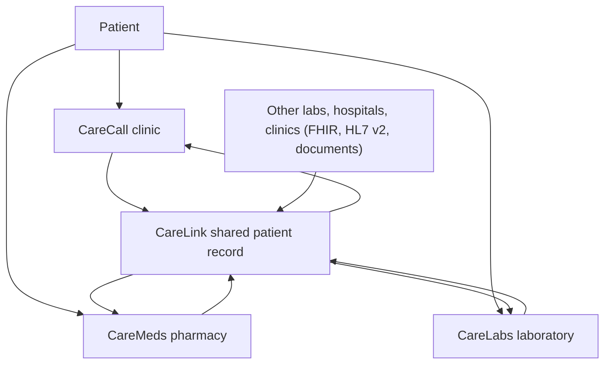
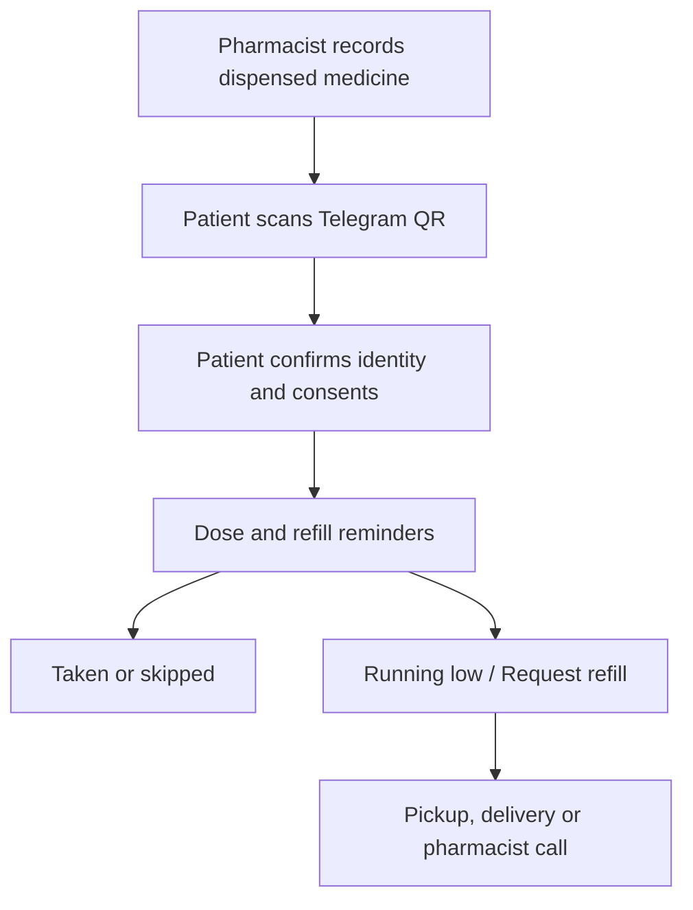

# Care platform: CareCall, CareMeds, CareLabs and CareLink

**Status:** Design (ideas and plan, nothing built yet beyond the clinic
product). **Roadmap:** phases O, CM, CL and L (F6–F8). **Last updated:** 14
October 2026

CareCallPH grows from a clinic product into a family of focused apps for
clinics, pharmacies and laboratories, joined by one patient record. This
document records the product idea, the boundaries that keep it safe, the
organization and permission model, and the order to build it in.

## 1. Product family

| Product | Primary customer | Main purpose |
|---|---|---|
| **CareCall** | Clinics | Patient recall, symptom checking, booking and appointment reminders (built) |
| **CareMeds** | Pharmacies and drugstores | Medicine schedules, adherence, refills, pickup and delivery |
| **CareLabs** | Laboratories and diagnostic centers (pathology and imaging) | Test booking, preparation instructions, specimen collection, result-ready notifications |
| **CareLink** | Clinics and care teams; the shared layer under all of them | The shared patient record: clinical notes, care plans, vital signs, medicines, lab results, follow-up and authorized data exchange |

**CareLink owns the patient record.** CareCall, CareMeds and CareLabs are
operational front ends: each runs its own workflow and contributes authorized
events (an appointment, a dispensed medicine, a lab result) to CareLink. No
front end "owns" the patient. This makes it straightforward to add hospitals,
imaging centers, home care and device monitoring later.

**CareLink is open to any source, not only CareLabs.** A patient's lab results
from any laboratory (CareLabs customers or not), a hospital discharge summary or
a clinic outside CareCall should be able to land in the same record, with their
source shown (section 6).



### Shared by every app (the platform)

Authentication and organizations; patient identity and consent; chat messaging
(Telegram first, then Viber, Messenger, WhatsApp, SMS); scheduling and
reminders; role-based access in the database; audit logs; privacy requests
(access, correction, restriction, erasure); notification preferences; the
clinic / pharmacy / lab directory; FHIR foundations.

### Deployment

One platform first, with CareMeds and CareLabs as modules or branded portals
(their own screens, landing page and wording, same database and functions).
Split into separately deployed apps only when a customer needs its own sales
channel, branding, release schedule or regulatory boundary. This avoids running
three systems too early.

## 2. Principles and boundaries

1. **Prescription is not the reminder schedule.** CareMeds keeps separate:
   - *Prescribed instruction*: entered from a valid prescription (or received from the clinic once M2 exists).
   - *Dispensing record*: what the pharmacy actually supplied (medicine, strength, quantity, date, batch optional).
   - *Reminder schedule*: derived from the prescribed instruction.
   - *Refill estimate*: calculated from quantity supplied and expected use.
   - *Pharmacist advice*: documented separately, within the pharmacist's permitted scope.

   CareMeds never changes a medicine, dose or duration by itself, and never
   renews a prescription automatically.
2. **Results are never sent in an ordinary message.** CareLabs says "Your
   result is ready", and the patient opens it through a secure, authenticated
   link, or the result is released through the requesting clinician. CareLabs
   does not interpret results or tell a patient they have a condition. Abnormal
   and critical results follow the laboratory's own escalation procedure.
3. **One identity, not one view.** A patient has one identity, but no
   organization sees the whole record by default. Access depends on consent,
   treatment relationship, role and purpose (section 4).
4. **Consent per purpose.** Medicine reminders, refill reminders, lab
   notifications and sharing with another organization each need the patient's
   recorded agreement, withdrawable any time (as `care_consents` does today).
5. **Out of scope for the first pilots:** controlled and dangerous drugs,
   automatic substitution, dose recommendations, automatic prescription
   renewal, and sending adherence or results to another organization without
   the patient's explicit permission.

## 3. Organizations, memberships and roles

A single role such as "pharmacist" is not enough: the same person can work at
a clinic and a pharmacy, and one business can run a pharmacy and a lab.

- **Organization**: name, **type** (clinic, pharmacy, laboratory), address and
  location, DOH or FDA license numbers, settings.
- **Membership**: user + organization + role (+ extra permissions). A user with
  two memberships chooses the organization when signing in, and can switch.

```
Maria Santos
  ├── Santos Clinic       — nurse
  └── Santos Pharmacy     — pharmacist
```

| Organization type | Example roles |
|---|---|
| Clinic | Clinic admin, front desk, nurse / assistant, doctor (today's roles) |
| Pharmacy | Pharmacy admin, pharmacist, pharmacy assistant, delivery staff |
| Laboratory | Lab admin, receptionist, phlebotomist, laboratory scientist / technologist, radiologic technologist, pathologist / radiologist |
| Platform | Platform admin, support, privacy auditor |
| Patient side | Patient, caregiver or authorized representative |

The selected membership decides the experience: pharmacists land in CareMeds,
lab staff in CareLabs, clinic staff in CareCall, and authorized clinicians can
open the CareLink record. Patients use chat and, later, a patient portal.

**Three separate questions, all checked in the database and APIs:**
1. *Organization type* decides which app and workflow apply.
2. *Role* decides what the user can do.
3. *Patient authorization or treatment relationship* decides which patients
   and which parts of the CareLink record they may see.

### Permission sketch

| Action | Pharmacist | Lab scientist | Clinic doctor |
|---|---|---|---|
| View the prescription needed for dispensing | Yes | No | Yes |
| Record medicine dispensed | Yes | No | View |
| Change a prescribed dose | No | No | Doctor workflow only |
| View a laboratory order | Limited (if relevant) | Yes | Yes |
| Enter or validate results | No | Yes | View |
| Sign a diagnostic report | No | Authorized lab role | No |
| View the CareLink record | Authorized sections | Authorized sections | Treatment-based |
| Book appointments | Pickup / pharmacist call | Diagnostic booking | Clinical booking |

Front desk anywhere sees scheduling, never clinical results or medicines.
Patients can see who accessed or contributed to their record.

### From today's model

Today each user belongs to one clinic; the login carries `role` (admin,
clinic_admin, staff), `clinic_id` and `clinical_role`, and every RLS policy uses
`jwt_clinic_id()`, `is_clinic_admin()`, `can_manage_care()`. The change:

1. `clinics` → `organizations` with `org_type` (existing rows become `clinic`);
   compatibility views keep the clinic code working during the move.
2. New `memberships` (user, organization, role, permissions, active).
3. Sign-in puts the *selected* membership into the token (a Supabase custom
   access-token hook): `org_id`, `org_type`, `org_role`. Switching organization
   refreshes the token.
4. RLS helpers move from clinic to organization (`jwt_org_id()`,
   `jwt_org_type()`, `has_org_role(...)`), with the clinic helpers rewritten on
   top of them so existing policies keep working, then migrated table by table.
5. Portal: organization picker at sign-in and in the sidebar; the sidebar and
   landing page follow the organization type.

This is one self-contained phase (O) and comes before any pharmacy or lab screen.

## 4. Patient identity and access

**Now:** each organization keeps its own patient list (as clinics do today:
unique by organization, phone and birthday). A pharmacy pilot needs nothing more.

**Later (CareLink shared record):**
- A **person** record (platform-wide) linked from each organization's patient
  record once matched: PhilHealth PIN, or name + birthday + mobile, confirmed by
  the patient in chat (as the chat invite's birthday check does) or by staff.
  Never merged automatically on a weak match.
- **Access grants**: which organization may see which sections of the record,
  for what purpose, until when. Created by the patient's consent (e.g. "share my
  medicine adherence with Santos Clinic") or by a treatment relationship (the
  clinic that ordered the test sees its result).
- **Access log** the patient can see: who looked at or added to their record.

### Sign-up at every organization (QR poster)

Clinics get a self sign-up page first (`/join/<clinic>`, branch
`patient-signup`): a new patient scans the poster at the front desk, enters
name, mobile and birthday, accepts the privacy notice and opts in to chat and
texts; a new record gets a chat invite that skips the birthday question. After
phase O the same page serves every organization type, at the drugstore counter
or lab reception.

**Same everywhere:**
- The poster opens that organization's own page; its own privacy notice and
  version are stored on the record.
- Chat and texts are optional and unticked; chat consent is still the patient's
  YES in the chat.
- One chat account can hold records at several organizations; each message
  names the sender.
- An existing match (same organization, mobile and birthday) is never changed
  and gets no chat link: staff use Invite to chat.

**By organization type:**

| | Clinic | Pharmacy | Laboratory |
|---|---|---|---|
| When | At the front desk, first visit | At the counter, after buying medicines | At reception, with the clinician's request |
| Extra opt-ins (unticked) | Appointment reminders | Dose and refill reminders; ready for pickup or delivery | Preparation instructions and reminders; "result ready" notices |
| Staff next | Book the follow-up | Pharmacist records what was dispensed; reminders start after YES | Reception attaches the test order; status updates follow |
| Limits | | Never changes a dose or renews a prescription | Results never in chat; opening a result needs a stronger check than sign-up (ID at the counter, or a one-time code) |

**Sharing between organizations** is a separate opt-in on its own screen, off
by default: it names who receives what (e.g. "share my medicine adherence with
Santos Clinic"), creates an access grant, and can be withdrawn anytime. Signing
up at a pharmacy never reveals or links the patient's clinic record; records
join into one CareLink person only when the patient confirms (above).

**Pilot shortcut (before phase O):** a partner drugstore can be set up as a
"clinic" to test demand for chat medicine reminders (M1), at the cost of
clinic wording on its screens. For a demand test only.

## 5. CareMeds (pharmacies and drugstores)

### MVP



| Step | Reuses | New |
|---|---|---|
| Record the sale: medicine, strength, quantity supplied, instructions as written on the prescription, prescriber reference, date | M1 medicines | Dispensing record (quantity, prescriber), pharmacy screens |
| Invite to chat by link or QR, birthday check | Chat invites | — |
| Consent | `care_consents` scopes | Scopes `refill_reminders` (and `medication_reminders`) for the pharmacy |
| Dose reminders, 1 taken / 2 skipped, missed after 2 hours, buttons | M1, Telegram buttons | — |
| Run-out estimate and refill reminder (e.g. 5 days before) | — | Estimate from quantity and doses per day; reminder |
| "Running low" / "Request refill" | Buttons | Refill request queue for the pharmacist |
| Pickup, delivery or pharmacist call | Booking slots (branch hours) | Choice and status: ready for pickup, out for delivery |
| Pharmacist follow-up for repeated missed doses or side effects reported | M4 alerts | Pharmacy action items |
| FHIR | MedicationRequest, MedicationAdministration | MedicationDispense |

### Three use cases

1. **Independent pharmacy service:** the drugstore offers free reminders and
   refill ordering to bring customers back and improve adherence.
2. **Clinic–pharmacy partnership:** the clinic sends a signed prescription
   (needs M2) to a partner pharmacy; the pharmacy dispenses it; reminders start
   after the patient agrees; adherence goes back to the clinic only with the
   patient's permission.
3. **Chronic-medicine program:** monthly refills for hypertension, diabetes,
   asthma and similar conditions; CareMeds flags people likely to run out or
   repeatedly missing doses.

Later: referral back to the prescriber; adherence summaries to the clinic
(with permission).

## 6. CareLabs and lab data in CareLink

### CareLabs (laboratories using CareCall)

- Book blood collection, X-ray, ultrasound and other tests: branch, date and
  time; home collection requests.
- Receive the clinician's request: uploaded by the patient, or sent by a
  CareCall clinic (ServiceRequest).
- Preparation instructions by test: fasting, medicines to discuss with the
  clinician, documents and ID to bring, arrival time, clothing.
- Reminders and rescheduling; queue or technician status; specimen collected;
  test in progress; **result ready** notification.
- Secure result retrieval (patient login), and release to the requesting
  clinician with the patient's authorization; results needing clinician review
  are flagged to the clinician, not explained to the patient.

### Lab data from any lab (CareLink)

CareLink accepts results from laboratories that don't use CareLabs, so a
patient's record is complete wherever they were tested:

| Route | For | Notes |
|---|---|---|
| FHIR API (DiagnosticReport + Observation) | Labs and hospitals whose systems speak FHIR | Preferred; authenticated per organization |
| HL7 v2 result messages (ORU^R01) | Most existing laboratory information systems | Translated to FHIR on receipt |
| Document upload (PDF or photo) | Any lab; by the patient or the clinic | Stored as the original document (DocumentReference); structured values only if entered or confirmed by staff (CC may draft them from the PDF, a person confirms), never invented |

Every result keeps its **provenance**: source organization, how it arrived,
when, and whether values were verified. Results go into the record of the
matched patient only (section 4); unmatched results wait for staff to match
them. The same rules apply: no result content in ordinary messages, no
interpretation, abnormal results to the clinician.

## 7. FHIR mapping (across the family)

| Event | FHIR resource |
|---|---|
| CareCall appointment | Appointment (built) |
| CareCall symptom intake | QuestionnaireResponse (F2) |
| Prescription | MedicationRequest (built for M1 medicines; M2 adds codes) |
| CareMeds dispensing | MedicationDispense |
| Dose response | MedicationAdministration (built) |
| Lab request | ServiceRequest |
| Specimen collected | Specimen |
| Lab result | Observation + DiagnosticReport |
| Uploaded report | DocumentReference |
| CareLink plan | CarePlan (built) |
| Vital-sign reading | Observation (built) |
| Who contributed what | Provenance |
| Sharing permission | Consent (built for care plans) |

## 8. Build order

1. **Now:** finish the clinic rehearsal and first pilot. This document.
2. **Phase O, organizations and memberships:** the foundation (section 3),
   including the sign-up page for every organization type (section 4).
3. **Phase CM, CareMeds MVP** (section 5), with one pharmacy partner.
4. **Clinic → pharmacy prescriptions:** after M2 (signed prescriptions).
5. **CareLink shared identity and access grants** (section 4), when two
   partner organizations need to share.
6. **Lab data in CareLink** from any lab (section 6): document upload first,
   then FHIR and HL7 v2 feeds with a partner lab.
7. **Phase CL, CareLabs:** booking, preparation, status and result-ready
   notifications, after patient login exists and with a lab partner.

## 9. Risks and open questions

- **Focus:** the clinic pilot comes first; CareMeds starts when a pharmacy
  partner is ready.
- **Regulation:** the Pharmacy Act (RA 10918) and FDA rules on pharmacist scope
  and generic names; DOH licensing for laboratories and how results may be
  released; the Data Privacy Act for every cross-organization share.
- **Channels:** pharmacy and lab customers include many older patients; Viber
  and Messenger reach more Filipinos than Telegram, so the Meta and Viber
  approvals matter more here; SMS fallback.
- **Market:** large chains run their own apps; independent drugstores, small
  chains and standalone labs are the likelier first customers. Refill revenue
  (pharmacy) and no-show reduction (lab) are the selling points.
- **Patient login:** secure result retrieval needs one (chat sign-in link plus
  birthday check, or one-time code). To design before CareLabs.
- **Names:** check "CareMeds" and "CareLabs" for trademarks and domains before
  printing anything.
- **Open:** pricing per organization type; whether delivery uses the
  pharmacy's own riders or a courier; how pharmacists record advice within their
  scope.
